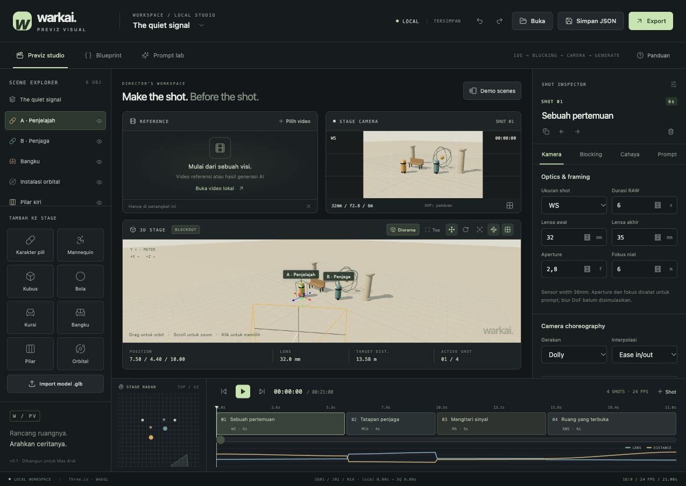

# warkai-previz-visual

Studio previz 3D yang berjalan lokal untuk Mas Ardi: terjemahkan konsep video menjadi blocking, kamera, timing dan prompt generasi AI. Dibangun dengan Three.js; proyek disimpan sebagai JSON atau YAML.



## Jalankan lokal

Kebutuhan: **Node.js 22.12+**, npm, browser dengan WebGL2. **FFmpeg dengan libx264** diperlukan untuk MP4 deterministik. Sesudah dependensi terpasang, editor dan renderer tidak memerlukan layanan AI atau koneksi internet.

```sh
npm ci
npm run dev
# Port terpisah untuk menguji checkpoint:
# WARKAI_PORT=4318 npm run dev
```

Buka **http://127.0.0.1:4317**. Di Mac yang sudah disiapkan, klik dua kali `start.command`. Script membuka studio atau memakai server yang sudah berjalan. Tutup Terminal dengan Control+C untuk menghentikan server yang diluncurkan script.

FFmpeg dapat tersedia di PATH, ditunjuk lewat variabel `WARKAI_FFMPEG`, atau lewat file lokal `.local/ffmpeg-path`. File ini berisi satu path absolut ke executable, tidak masuk Git. `start.command` juga dapat membaca `.local/node-path` pada komputer yang memakai runtime Node terpisah.

```sh
WARKAI_FFMPEG=/path/to/ffmpeg npm run dev
npm test
npm run test:render # memerlukan FFmpeg
npm run build
# npm run preview juga menyediakan API render lokal melalui plugin Vite.
```

## Workflow

1. Buka demo atau import `examples/quiet-signal.json`. Video referensi dipilih dari komputer dan tetap lokal.
2. Tambahkan Pill, Pill kepala bola, kubus, bola, kursi, bangku, pilar, orbital, panel atau GLB mandiri. Karakter selalu diberi nama unik dan kode stabil CHAR_001, CHAR_002, dst.
3. Pilih objek di Scene Explorer. Atur skala, warna, posisi dasar dan arah hadap.
4. Pilih shot. Atur durasi RAW, lensa awal/akhir, kamera/look-at awal/akhir, serta gerakan dan easing. “Ambil view” mengambil posisi diorama sebagai pose kamera.
5. Di Blocking, atur posisi awal/akhir, aksi, postur dan arah hadap per shot. End pose diteruskan ke shot berikutnya.
6. Periksa Stage Camera, diorama, radar dan kurva lensa/jarak. Space untuk playback; scrubber untuk inspeksi.
7. Buka Blueprint untuk score YAML dan metadata RAW/job/EDIT sequence. Export MP4, frame, contact sheet, score, manifest atau prompt.

**Prompt Lab bersifat offline**: membaca kata kunci seperti dolly/orbit/crane, ukuran lensa `50mm` dan durasi `6 detik`; bukan model bahasa dan bukan rekonstruksi otomatis video. Prompt hasil ekspor selalu dibangun dari data stage saat ini. Tidak ada panggilan generator berbayar.

## Revisi Director dan cerita (CP002)

- **Dari cerita**: tempel teks atau impor TXT/MD/DOCX/PDF bertulisan (maksimal 15 MB, PDF 100 halaman). Planner lokal memecah paragraf menjadi draf shot, membaca kata kunci teknis, dan mempertahankan teks asli dalam `sourceStory`. Tinjau draf sebelum membukanya. PDF scan memerlukan OCR terpisah; posisi, set dan aksi tidak direkonstruksi secara semantik.
- **Director per shot**: `dolly 50mm 6 detik; cam in (4,2,7); cam out (2,1.5,4); target in (0,1,0); target out (0,1,0)`. Mendukung `lens in/out`, `f/2.8`, `fokus 4`, `linear/smooth`, `orbit -360 derajat`. Revisi teknis mempertahankan aksi; `aksi: teks baru` menggantinya secara eksplisit.
- **Camera line**: jalur solid dengan panah arah, key IN/OUT posisi kamera dan target. Pilih label/key lalu geser gizmo, edit koordinat, atau gunakan Ambil view. Sweep +360/−360 membedakan arah satu putaran penuh; roll IN/OUT juga tersedia. Dengan sweep eksplisit, sudut OUT mengikuti sweep; radius/tinggi/target OUT dapat direvisi.
- **Sisip shot**: tombol Sebelum/Sesudah pada timeline menyisip shot 5 detik dengan kamera dari key tetangga. ID lama tetap; penempatan EDIT shot sesudahnya dalam sequence yang sama digeser. Tinjau durasi, aksi dan blocking insert sebelum produksi.
- **Hapus objek**: pilih objek lalu Backspace/Delete atau klik kanan → Hapus. Undo mengembalikan perubahan. Penghapusan juga membersihkan blocking, state dan practical light yang merujuk objek.
- **State properti**: visibilitas, warna, plate dan crop gambar per shot. Panel memakai gambar lokal embedded, maksimal 4 MB/gambar. Skala XYZ, pitch dan roll mendukung properti seperti flap.
- **Cahaya per shot**: scene, black atau local; black benar-benar menghasilkan frame hitam. Local memerlukan practical/emisi yang ditentukan; lampu terikat objek memakai offset sumbu dunia, bukan koordinat lokal rig.

Contoh: `examples/named-pill-characters.json`, `camera-360.json`, `prop-states-lighting.json`, `uv-regions.json`.
Schema `/2` melindungi fitur baru dari pembacaan keliru di CP001. Proyek lama `/1` tetap diterima; tipe `human` lama dimigrasikan ke Pill kepala bola, dengan nama/posisi/skala dipertahankan. Preview ini tidak lagi menawarkan mannequin.

## Output dan timing

- **MP4 H.264 / yuv420p**, render PNG per frame ke FFmpeg; fps 24, 25 atau 30. Durasi/urutan cut mengikuti frame proyek, terlepas dari kecepatan render komputer.
- Sisi terpanjang video maksimal 1280 px. Dimensi dipilih sebagai kelipatan rasio asli dan bilangan genap. Contoh 16:9 → 1280×720; 48:9 → 1248×234.
- Jika FFmpeg belum tersedia, browser capture WebM/MP4 menjadi fallback. **Fallback tidak menjamin timing frame-akurat.**
- Export video saat ini adalah **RAW seluruh shot menurut urutan timeline proyek**, tanpa audio. Trim EDIT dan offset sequence disampaikan melalui manifest JSON/CSV; belum ada conform timeline EDIT otomatis.
- PNG kamera bersih dan contact sheet start/end; grid dapat dimatikan sebelum ekspor. UI label, gizmo dan frustum tidak ikut dirender.
- JSON/YAML memuat proyek, termasuk GLB embedded. Referensi video tidak disertakan; pilih ulang setelah reload.
- Autosave memakai IndexedDB browser/origin ini. Simpan JSON untuk backup dan pindah perangkat.

Durasi shot minimal satu frame dan maksimal 60 detik, sampai 120 shot/30 menit. Untuk batas per 0,1 detik gunakan **30 fps**. Contoh 0,9 detik = 27 frame pada 30 fps; pada 25 fps nilainya 22,5 frame dan ditolak agar timing tidak diam-diam bergeser.

Lihat [schema dan pemetaan waktu](docs/PROJECT_FORMAT.md), [hasil pengujian](docs/QC.md), dan [checkpoint kerja](docs/CHECKPOINT.md).

## Batas versi 0.2

Ini aplikasi lokal, belum layanan multiuser dengan akun, billing, cloud storage atau hosting publik. Pill dan Pill kepala bola adalah stand-in untuk menyutradarai blocking. Cue postur stand/sit/kneel/crouch/lie menandai tinggi tubuh dan eyeline secara sederhana; bukan rig karakter atau simulasi anatomi. Aperture/focus dicatat untuk prompt; blur DoF belum disimulasikan. Dolly/truck/crane menginterpolasi dua pose, orbit memakai busur terpendek bila orbitDegrees kosong, atau sweep bertanda sampai ±1080°, handheld menambah goyangan kecil deterministik. GLB memakai animasi pertama jika tersedia, tanpa pemilihan clip atau retargeting. GLB mandiri maksimal 12 MB, tanpa Draco.

Previz adalah referensi ruang, kamera dan timing. Hasil video generatif tidak dijamin mereplikasi piksel previz atau parameter optik secara persis.

## Referensi desain workflow

- Video WhatsApp yang diberikan Mas Ardi: graybox kapsul, properti, perubahan framing, gerak kamera dan efek orbital. Media aslinya tidak disertakan di repositori.
- [Stage Anatomy / Taruma Sakti](https://www.instagram.com/reel/DfulyrjBKpl/): gagasan melihat monitor kamera, diorama, radar, telemetry dan score secara terpadu. Implementasi dan demo di sini dibuat sendiri; tidak mengambil kode atau aset postingan.
- [Dokumentasi Three.js](https://threejs.org/docs/).
